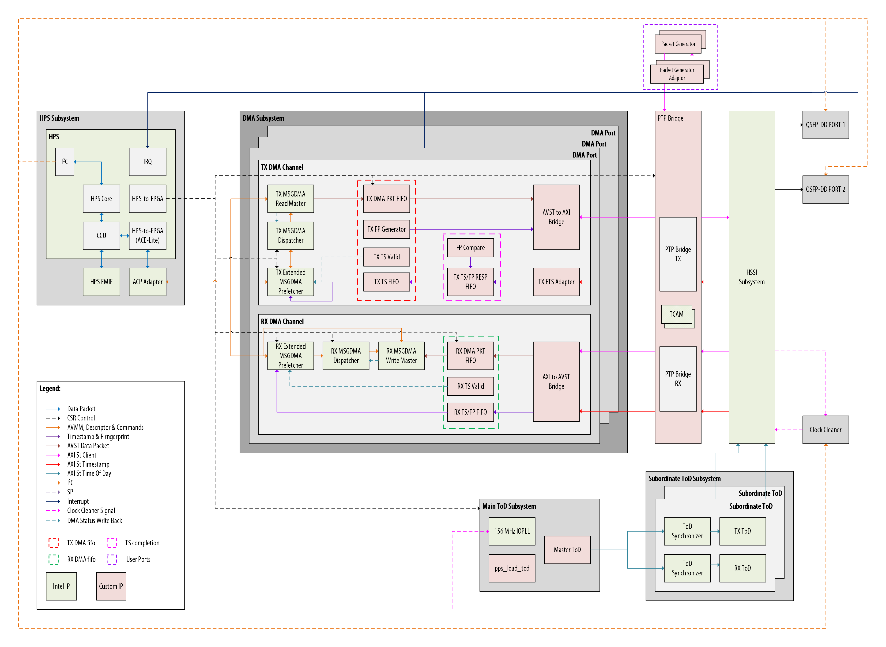

# Agilex™ 7 IEEE 1588 PTP Multi-Channel QoS System Example Design

## Description

The Agilex™ 7 IEEE 1588 PTP Multi-Channel QoS System Example Design demonstrates Ethernet and IEEE 1588v2 PTP functionality of the Altera Agilex™ 7 FPGA supporting F-Tile transceivers. It provides a 2-port design leveraging the Ethernet Subsystem FPGA IP with Multi-Channel QoS (MCQoS) support.

The System Example Design (SED) provides the necessary drivers and user applications to support the Linux Network stack and the Linux PTP stack on the HPS.

The system's primary components include:

- The Hardware Reference Design
- Hard Processor Subsystem (HPS)
- Channelized Modular Scatter-Gather Direct Memory Access (MSGDMA) Subsystem
- Main Time of Day (ToD) Subsystem
- Channelized Subordinate ToD Subsystem
- PTP Bridge Subsystem
- Packet Generator
- High-Speed Serial Interface (HSSI) Subsystem
- Reference HPS software including:
  - Arm Trusted Firmware
  - U-Boot
  - Linux Kernel
  - Linux Drivers
  - User Space Applications



Important features of the design include:

- Support for both ordinary and boundary clock configurations
- PTP software stack running on the HPS that handles generation of PTP messages and local Time of Day (ToD) adjustments
- Programmable QoS and packet routing functionality handled within the PTP Bridge Subsystem
- Multiple DMA engines to efficiently transfer data between the HPS and HSSI

The System Example Design supports the following design configuration on Altera Development Kits.

| SL No | Design configuration                                      | Data-rate options                                      | Development Kit Supported                                                                 | Device Family | Device Part       | Documentation                             |
| ----- | --------------------------------------------------------- | ------------------------------------------------------ | ----------------------------------------------------------------------------------------- | ------------- | ----------------- | ----------------------------------------- |
| 1.    | 2-port IEEE 1588v2 PTP with Multi-Channel QoS (F-Tile)    | 10G / 25G / 50G / 100G (with optional ANLT) and DR     | [DK-SI-AGI027FD](https://www.altera.com/products/devkit/po-3248/agilex-7-fpga-i-series-transceiver-soc-development-kit-4x-f-tile) | Agilex™ 7     | AGIB027R31B1E1V   | [Build README](./dk-si-agi027fd-oobe/ptp/README.md) |

## Repository Structure

Directory Structure Used in This Example Design:

```bash
agilex7-ed-ptp
|--- doc/
|--- dk-si-agi027fd-oobe/
|   |--- ptp/                   # 2-port IEEE 1588 PTP MCQoS, I-Series F-Tile kit
```

The design directory contains `src/`, `synth/`, and `software/` (see the design README for details).

## Getting Started

Building the design is easy with the scripts provided in the repo. Clone the repository to get the source files.

```bash
git clone https://github.com/altera-fpga/agilex7-ed-ptp.git
cd agilex7-ed-ptp
git checkout <Release Tag>
```

Follow the links below to compile, build, and test the design solution.

- [Building IEEE 1588 PTP MCQoS on DK-SI-AGI027FD](./dk-si-agi027fd-oobe/ptp/README.md)

Run `make help` from the design directory for the full target list. Use `PTP_DESIGN=<rate>` to select the Ethernet rate variant (default `25G_ANLT`).
